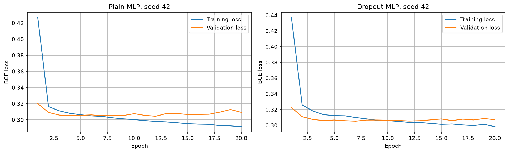

# Adult Income ML

## Project summary
This project predicts whether a person earns more than 50K per year using the Adult dataset from OpenML, version 2. It compares classification pipelines and a PyTorch neural network.

## Project files
- `01_eda.ipynb`: dataset exploration (Part 1).
- `02_models.ipynb`: preprocessing, model comparison, error analysis and PyTorch (Parts 2 to 4).
- `figures/learning_curve.png`: training and validation loss for both networks.
- `requirements.txt`: Python packages.

## How to run
Tested notebook environment must include Python, numpy, pandas, scikit-learn, matplotlib, torch and jupyter. The notebook was generated and run using Python 3.14.5.

```powershell
py -m venv .venv
.\.venv\Scripts\python.exe -m pip install -r requirements.txt
.\.venv\Scripts\python.exe -m notebook
```

Run `01_eda.ipynb`, then `02_models.ipynb` using Restart Kernel and Run All Cells. The random seed for the train/test split is 42; the PyTorch experiments use seeds 42 to 46. OpenML downloads the dataset automatically.

## Preprocessing and leakage prevention
Data is split 80/20 using stratification before fitting transformations. The preprocessing object imputes numeric missing values with the median, scales numeric columns, imputes categorical missing values using the most frequent category and one-hot encodes categories. The preprocessor is fitted only on training folds or the PyTorch training subset. The test set is never used to choose the model parameters.

## Baselines: 5-fold CV
| Model | accuracy mean | accuracy std | precision mean | precision std | recall mean | recall std | f1 mean | f1 std | roc_auc mean | roc_auc std |
| --- | --- | --- | --- | --- | --- | --- | --- | --- | --- | --- |
| Majority Dummy | 0.7607 | 0.0000 | 0.0000 | 0.0000 | 0.0000 | 0.0000 | 0.0000 | 0.0000 | 0.5000 | 0.0000 |
| Logistic Regression | 0.8513 | 0.0051 | 0.7325 | 0.0170 | 0.5966 | 0.0070 | 0.6576 | 0.0098 | 0.9055 | 0.0038 |

## Classical models: 5-fold CV
| Model | ROC AUC mean | ROC AUC std | F1 mean | F1 std |
| --- | --- | --- | --- | --- |
| Logistic Regression | 0.9055 | 0.0038 | 0.6576 | 0.0098 |
| Random Forest | 0.9009 | 0.0043 | 0.6653 | 0.0089 |
| Hist Gradient Boosting | 0.9276 | 0.0024 | 0.7082 | 0.0085 |

## Boosting parameter search
Tried values: {'model__learning_rate': [0.05, 0.1], 'model__max_depth': [5, 10], 'model__max_iter': [100, 200]}.

Best values: {'model__learning_rate': 0.05, 'model__max_depth': 10, 'model__max_iter': 200}. Best CV ROC AUC: 0.9275.

## Final test-set comparison
| Model | Accuracy | Precision | Recall | F1 | ROC AUC |
| --- | --- | --- | --- | --- | --- |
| Logistic Regression | 0.8524 | 0.7414 | 0.5885 | 0.6562 | 0.9042 |
| Random Forest | 0.8602 | 0.7430 | 0.6356 | 0.6851 | 0.9038 |
| Tuned Hist Gradient Boosting | 0.8768 | 0.7929 | 0.6565 | 0.7183 | 0.9290 |
| Plain MLP | 0.8574 | 0.7406 | 0.6252 | 0.6766 | 0.9114 |
| Dropout MLP | 0.8580 | 0.7482 | 0.6140 | 0.6740 | 0.9123 |

The two MLP rows are means of five test-set evaluations with different training seeds. Each classical model has one final fitted-model evaluation. MLP results should not be treated as directly controlled comparisons because training uses an internal validation split.

The highest baseline cross-validation ROC AUC among the three classical model families is achieved by **Hist Gradient Boosting**. The boosting model was tuned on training folds. No parameters were chosen using test-set scores. Boosting CV-to-test ROC AUC difference: +0.0014. A small gap does not prove that leakage is absent.

## Neural network training curves


Both models use 64 and 32 hidden units, ReLU, BCEWithLogitsLoss, Adam (learning rate 0.001), batch size 256 and 20 epochs. Dropout is 0.2 in the regularised model. These are simple starting choices, not results of neural-network hyperparameter tuning.

Neural network five-seed standard deviations:
| Model | Accuracy | Precision | Recall | F1 | ROC AUC |
| --- | --- | --- | --- | --- | --- |
| Dropout MLP | 0.0008 | 0.0147 | 0.0249 | 0.0096 | 0.0005 |
| Plain MLP | 0.0012 | 0.0246 | 0.0430 | 0.0168 | 0.0008 |

Mean minimum validation loss for Plain MLP: 0.3042; for Dropout MLP: 0.3047. Compare those results and the plotted loss curves before claiming that dropout helped.

## Error analysis
The notebook compares false negatives, true positives and true negatives by occupation, education number, working hours, capital gain and sex. Five errors are selected by distinct conditions, not just by row order. It also reports group-level precision and recall by sex and race.

- False negatives have an average education-num of 10.08, versus 12.40 for true positives.

- Average weekly hours are 44.12 for FN, 46.26 for TP, and 38.17 for TN.

- The share with a positive capital-gain is 0.62% among FN and 33.94% among TP.

- Among false negatives, 81.20% are Male, compared with 86.32% among true positives.


Group-level metrics:
| Feature | Group | Rows | Precision | Recall |
| --- | --- | --- | --- | --- |
| sex | Female | 3259 | 0.8015 | 0.5817 |
| sex | Male | 6510 | 0.7915 | 0.6702 |
| race | Amer-Indian-Eskimo | 96 | 1.0000 | 0.3077 |
| race | Asian-Pac-Islander | 311 | 0.6962 | 0.6707 |
| race | Black | 968 | 0.8706 | 0.5736 |
| race | Other | 82 | 1.0000 | 0.6000 |
| race | White | 8312 | 0.7923 | 0.6635 |

## Key findings
- The majority-class dummy baseline shows why accuracy by itself is insufficient.
- Stratified cross-validation reports variation across training folds.
- Correlated features can share permutation importance.
- The PyTorch networks use fewer weight-update rows because part of the training data is held out for validation.

## Limitations and ethics
This is a demonstration experiment, not a model for employment, lending or individual decisions. The Adult census-style data is historical, may not represent current populations, and contains sensitive attributes such as sex and race. Proxy features can preserve group-related information even if sensitive attributes are removed. Before real use, check dataset representativeness, group-level errors, calibration, privacy and relevant regulations.

## What was hard and what needs checking
The main challenges were making preprocessing reproducible, keeping CV separate from test evaluation, comparing MLP losses, and reporting numbers consistently. The complete notebook should be reviewed and rerun locally.

## Target-label cleanup
The earlier code used `.rstrip('.')` on the target labels, but OpenML Adult version 2 does not add a trailing period to its labels. That operation was removed here. The provenance of that earlier line has not been established.