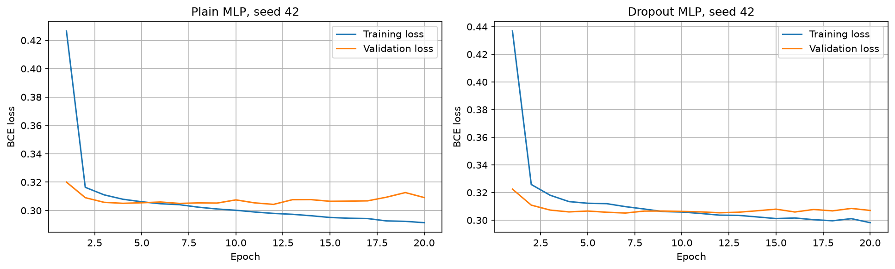

# Adult Income ML

## Project summary

In this project, I used the Adult Income dataset from OpenML (version 2) to predict whether a person earns more than 50K per year. I explored the data, compared several classical machine-learning models, and trained two neural networks in PyTorch. My goal was not only to get a good score, but also to understand how the models are evaluated and what their mistakes tell us.

## Project files

- `01_eda.ipynb` — data exploration, visualisations and observations (Part 1).
- `02_models.ipynb` — preprocessing, baseline models, model comparison, error analysis and neural networks (Parts 2–4).
- `figures/learning_curve.png` — training and validation loss curves for the neural networks.
- `requirements.txt` — main Python dependencies.

## How to run

**Python:** 3.12 or newer. The saved notebook results were produced with Python 3.14.5.

Open PowerShell in the repository folder and run:

```powershell
py -m venv .venv
.\.venv\Scripts\python.exe -m pip install -r requirements.txt
.\.venv\Scripts\python.exe -m jupyter lab
```

The launch command above uses JupyterLab, which is included in the simplified `requirements.txt`. Open `01_eda.ipynb` first, then `02_models.ipynb`. For each notebook, select the Python kernel, choose **Restart Kernel and Run All Cells**, and save the notebook with its outputs.

The dataset is downloaded from **OpenML Adult, version 2**. Internet access may be needed on the first run. The train/test split uses seed **42**, and the PyTorch experiments use seeds **42–46**. The README is edited manually; running the notebooks no longer creates or overwrites it.

The saved outputs show completed notebook runs. A fresh installation in a new virtual environment has **not been confirmed in this README**, so it should not be described as tested until that check is performed.

## Data and preprocessing

The Adult dataset contains **48,842 rows** and **14 input features**. I use an **80/20 stratified train/test split** so that both sets keep approximately the same class proportions.

A single preprocessing definition is reused in the model pipelines:

- Missing numerical values are filled with the median, and numerical features are scaled.
- Missing categorical values are filled with the most frequent category, and categorical features are one-hot encoded.
- The preprocessor is fitted on training folds or the neural-network training subset, not on the held-out test set.

This separation is important because preprocessing fitted on the test set could cause **data leakage** and make the results look better than they really are. I used the test set for final evaluation, not for selecting hyperparameters. However, a small difference between CV and test scores alone cannot prove that leakage is absent.

## Baselines: 5-fold cross-validation

| Model | Accuracy mean | Accuracy std | Precision mean | Precision std | Recall mean | Recall std | F1 mean | F1 std | ROC AUC mean | ROC AUC std |
| --- | ---: | ---: | ---: | ---: | ---: | ---: | ---: | ---: | ---: | ---: |
| Majority Dummy | 0.7607 | 0.0000 | 0.0000 | 0.0000 | 0.0000 | 0.0000 | 0.0000 | 0.0000 | 0.5000 | 0.0000 |
| Logistic Regression | 0.8513 | 0.0051 | 0.7325 | 0.0170 | 0.5966 | 0.0070 | 0.6576 | 0.0098 | 0.9055 | 0.0038 |

The majority-class baseline reaches **76.07% accuracy**, but it never identifies a high-income person. This showed me why accuracy alone is not enough for this dataset. Recall, F1 and ROC AUC help describe performance more clearly.

## Classical models: 5-fold cross-validation

| Model | ROC AUC mean | ROC AUC std | F1 mean | F1 std |
| --- | ---: | ---: | ---: | ---: |
| Logistic Regression | 0.9055 | 0.0038 | 0.6576 | 0.0098 |
| Random Forest | 0.9009 | 0.0043 | 0.6653 | 0.0089 |
| Hist Gradient Boosting | 0.9276 | 0.0024 | 0.7082 | 0.0085 |

Hist Gradient Boosting had the highest mean ROC AUC and F1 among these classical models in cross-validation.

## Boosting parameter search

I used `GridSearchCV` to search the following values:

- `model__learning_rate`: 0.05, 0.1
- `model__max_depth`: 5, 10
- `model__max_iter`: 100, 200

The best searched combination was **learning rate 0.05, maximum depth 10, and 200 iterations**. Its mean CV ROC AUC was **0.9275**. The default Hist Gradient Boosting model scored **0.9276**, so the search **did not improve the result**. The difference is very small.

I use the name **Tuned Hist Gradient Boosting** in the final table because that model uses the parameters selected by the search, **not** because tuning made it better than the default model.

## Final test-set comparison

| Model | Accuracy | Precision | Recall | F1 | ROC AUC |
| --- | ---: | ---: | ---: | ---: | ---: |
| Logistic Regression | 0.8524 | 0.7414 | 0.5885 | 0.6562 | 0.9042 |
| Random Forest | 0.8602 | 0.7430 | 0.6356 | 0.6851 | 0.9038 |
| Tuned Hist Gradient Boosting | 0.8768 | 0.7929 | 0.6565 | 0.7183 | 0.9290 |
| Plain MLP | 0.8574 | 0.7406 | 0.6252 | 0.6766 | 0.9114 |
| Dropout MLP | 0.8580 | 0.7482 | 0.6140 | 0.6740 | 0.9123 |

**I recommend Hist Gradient Boosting** for this experiment. It achieved the best test **ROC AUC (0.9290)**, **F1 (0.7183)** and **accuracy (0.8768)** among the tested models. I think one possible reason is that boosting handles nonlinear relationships and feature interactions in tabular data well.

Its test ROC AUC was about **0.0014 higher** than the tuned CV ROC AUC when using the unrounded results. This is a small difference and suggests similar performance on the validation folds and test data. It does not, by itself, prove there was no leakage.

The two MLP rows are means across five training seeds. Each classical model has one final test-set evaluation. The comparison is not perfectly controlled: the MLP models used an internal validation split and trained their weights on **31,258 rows**, compared with **39,073 training rows** for the classical models.

## Neural network training and learning curves



Both networks have hidden layers of **64 and 32 units**, ReLU activation, `BCEWithLogitsLoss`, and the Adam optimizer with a **0.001 learning rate**. They use a batch size of **256** for **20 epochs**. The second network includes **0.2 dropout**.

I chose a small network and a learning rate of 0.001 as reasonable starting points, not because a hyperparameter search proved that they were optimal. A future experiment could try other network sizes and learning rates.

For seed 42, the **Plain MLP** reached its lowest validation loss of **0.3043 at epoch 12**, but validation loss increased to **0.3092 at epoch 20** while training loss continued to decrease. This is a sign of **mild overfitting**. The **Dropout MLP** also showed a small increase in validation loss after its minimum (**0.3052 at epoch 7**). Both models learned useful patterns, so I would not call them strongly underfitting. I would try **early stopping** for both.

### Did dropout help?

Overall, **not convincingly**. Across five seeds, the mean ROC AUC increased only from **0.9114 ± 0.0008** (Plain MLP) to **0.9123 ± 0.0005** (Dropout MLP). But recall decreased from **0.6252** to **0.6140**, and F1 decreased from **0.6766** to **0.6740**. The mean minimum validation loss was also slightly worse with dropout: **0.3047** versus **0.3042**.

This small ROC AUC gain is not enough for me to say that dropout improved the model overall. I would try the plain network with early stopping before adding more regularisation.

Five-seed standard deviations:

| Model | Accuracy | Precision | Recall | F1 | ROC AUC |
| --- | ---: | ---: | ---: | ---: | ---: |
| Dropout MLP | 0.0008 | 0.0147 | 0.0249 | 0.0096 | 0.0005 |
| Plain MLP | 0.0012 | 0.0246 | 0.0430 | 0.0168 | 0.0008 |

## Error analysis

I compared **false negatives (FN)**, **true positives (TP)** and **true negatives (TN)**, and inspected selected mistakes in the notebook.

- FN records have a lower average `education-num` than TP records: **10.08 vs 12.40**. The model seems to have more difficulty recognising some high-income people with lower education levels.
- Average weekly hours are **44.12 for FN**, **46.26 for TP** and **38.17 for TN**. Working hours alone cannot explain all predictions.
- Only **0.62% of FN** records have positive capital gain, compared with **33.94% of TP** records. The model may rely strongly on this signal when predicting high income.
- `Craft-repair` represents about **22.6% of FN** records but only **7.1% of TP** records. This is one group of mistakes I would investigate further.

Next, I would study errors by education and occupation, and try different classification thresholds using **validation data**, while checking the trade-off between precision and recall.

### Metrics by demographic group

| Feature | Group | Rows | Precision | Recall |
| --- | --- | ---: | ---: | ---: |
| sex | Female | 3259 | 0.8015 | 0.5817 |
| sex | Male | 6510 | 0.7915 | 0.6702 |
| race | Amer-Indian-Eskimo | 96 | 1.0000 | 0.3077 |
| race | Asian-Pac-Islander | 311 | 0.6962 | 0.6707 |
| race | Black | 968 | 0.8706 | 0.5736 |
| race | Other | 82 | 1.0000 | 0.6000 |
| race | White | 8312 | 0.7923 | 0.6635 |

The `Amer-Indian-Eskimo` and `Other` groups have only **96** and **82** test records. Their precision of **1.0000** does **not** prove that the model makes perfect predictions for these groups. Small samples make these estimates unreliable.

## Key findings from EDA and error analysis

1. The dataset is imbalanced: **76.07%** of records belong to the `<=50K` class. A model can have fairly high accuracy and still miss all high-income cases.
2. The share of people earning above 50K increases from **6.67%** for those working 1–29 hours to **40.90%** for those working 51+ hours. This is an association, not proof that longer work hours cause higher income.
3. Among people with positive capital gain, **61.73%** earn above 50K, compared with **20.52%** when capital gain is zero. The maximum `capital-gain` is the coded value **99999**, appearing in **244** records.
4. False negatives have a lower average education number than true positives (**10.08 vs 12.40**) and are much less likely to have positive capital gain (**0.62% vs 33.94%**).
5. Permutation importance ranks `marital-status` (**0.0999**) and `capital-gain` (**0.0615**) highest. This mostly supports my expectation that capital gain would be useful, while marital status was more important than I expected. Importance does not prove causation.

## Limitations and ethics

This is a learning experiment, not a model for employment, lending, or decisions about individual people. The Adult dataset is historical and may not represent people today. It also contains sensitive features such as sex and race. Other features, such as occupation and relationship, can act as proxies for demographic information. Before any real use, the data, group-level errors, calibration, privacy and relevant regulations would need much more careful checking.

## What I learned and what was difficult

This was my **first serious Python project**. Before this, I had mainly used Python for simple things, such as calculators, so working with a full dataset and several libraries was new to me.

I also wanted to understand **how machine learning works in a more scientific way**, instead of just thinking that a neural network somehow makes predictions. I spent time trying to understand training, validation, metrics, and why different models can get different results. I learned that a higher accuracy score does not always mean a better model.

**Jupyter Notebook** was another new tool for me. I had to learn how notebooks, cells, kernels and saved outputs work. I also found **GitHub** challenging at first, especially keeping track of changes, commits and updated files. Working with both the code and the written explanations was harder than I expected.

I still have more to learn, but this project helped me understand the complete ML workflow much better, from exploring data to evaluating models and explaining their errors.

## Target-label cleanup

I used `.rstrip('.')` as a precaution because removing trailing dots is a common practice when cleaning text labels in datasets.

Some versions of the Adult dataset contain labels like `>50K.` instead of `>50K`, so I wanted to avoid possible problems with inconsistent labels.

Later, I found out that OpenML Adult version 2 already has labels without trailing dots. This made the operation unnecessary.
I included it just to be safe, even though it turned out that I did not need it.

